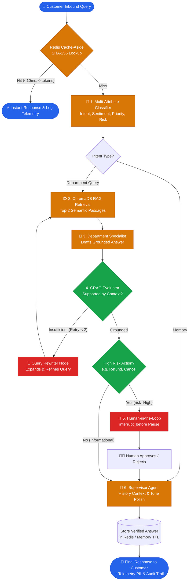

# 🎓 AI-Powered Customer Support Automation System
## Complete Workflow Walkthrough & Core Interview Q&A Guide

> **Target Length:** Concise reference guide (< 8 pages)  
> **Purpose:** Everything you need to explain every workflow step end-to-end, defend technical decisions, and nail senior-level technical interviews.

---

## 1. System Architecture & High-Level Flow



---

## 2. End-to-End Workflow Walkthrough (Step-by-Step)

Here is the exact lifecycle of an inbound customer message across the entire pipeline:

### Step 0: Redis Cache-Aside Acceleration Layer
* **Trigger:** Customer submits a message in the UI (`app.py`).
* **Mechanism:** The message is normalized (lowercased, whitespace-stripped) and hashed via SHA-256 (`cache:support:<hash>`).
* **Cache Hit:** If found in Redis (or in-memory fallback), the response is returned immediately in **< 10ms**, consuming **0 LLM tokens**, and an audit row is logged with latency and 0 token cost.
* **Cache Miss:** The query proceeds into the LangGraph state machine.

### Step 1: Single-Pass Multi-Attribute Triage (`classifier_node`)
* **Model:** Groq LPU (`qwen/qwen3.8-27b`).
* **Structured Output:** Enforces strict Pydantic schema validation (`IntentOutput`).
* **Extracted Attributes in a Single Inference Pass:**
  1. `intent`: `Technical`, `Billing`, `Sales`, `Account`, or `Memory`.
  2. `sentiment`: `Frustrated`, `Neutral`, `Positive`, or `Urgent`.
  3. `priority`: `High`, `Medium`, or `Low`.
  4. `risk`: `High` (demanding financial or account modifications) vs `Low` (informational questions).
  5. `ticket_id`: Auto-generated incident identifier (`#TKT-XXXX`).
* **Efficiency:** Extracts 5 dimensions in 1 LLM call instead of chaining 4 sequential LLM calls, saving ~75% latency and token cost.

### Step 2: Context Retrieval (`retrieve_context`)
* **Vector Store:** ChromaDB in-memory index loaded with company support documentation.
* **Embedding Model:** Local HuggingFace `all-MiniLM-L6-v2` (384-dimensional dense vectors).
* **Action:** Performs cosine similarity search using the current query (or rewritten query) and extracts the top 2 document chunks (`k=2`).

### Step 3: Department Specialist Reasoning (`department_node`)
* **Routing:** Dynamically routes to the assigned department persona (Technical Support, Billing Representative, Sales Consultant, Account Manager).
* **Role:** Drafts an initial factual response strictly bounded to the retrieved documentation.

### Step 4: Corrective RAG (CRAG) Cyclical Self-Correction (`evaluate_grounding`)
* **True Cyclic Feedback:** If the draft relies on missing information or context similarity is inadequate:
  1. The state tracks `retry_count`.
  2. If `retry_count < 2`, execution branches to `rewrite_query`.
  3. `rewrite_query` expands abbreviations, strips emotional noise, and generates an optimized search keyword set.
  4. The graph loops **back to `retrieve_context`** with the new search terms.
* **Safety:** If maximum retries (2) are reached without confident context, it gracefully falls back without hallucinating.

### Step 5: Semantic Human-in-the-Loop (HITL) Gate
* **Condition:** Evaluates both model-assessed `risk == "High"` and sensitive action intent.
* **Execution Pause:** LangGraph pauses execution right before the `human_approval` node (`interrupt_before=["human_approval"]`).
* **State Checkpoint:** The entire state graph freezes and saves to the SQLite checkpointer (`SqliteSaver`).
* **Supervisor Action:** The UI renders an actionable Management Authorization Card. The human agent reviews the proposed draft and clicks **"Authorize"** or **"Reject"**.
* **Resumption:** On authorization, LangGraph resumes from the saved checkpoint thread without re-running prior nodes.

### Step 6: Supervisor Polish & De-escalation (`supervisor_agent`)
* **Role:** Reviews the department specialist's draft for quality, empathy, and brand voice.
* **Sentiment Adaptation:**
  * If sentiment is `Frustrated` or `Urgent`, the supervisor injects calming, proactive de-escalation language.
  * If the query is an ongoing multi-turn dialogue (`Memory`), it synthesizes past conversational turns.

### Step 7: Telemetry, Cache Storage & Audit Logging
* **Token Reducer:** LangGraph uses `Annotated[int, operator.add]` to accumulate tokens across all visited nodes.
* **Cache Write:** Verified static FAQ answers are saved to Redis with a 1-hour TTL.
* **SQLite Audit Trail:** Logs `ticket_id`, timestamp, user query, final answer, intent, sentiment, priority, approval status, latency (seconds), and total token consumption into `ticket_logs`.
* **RLHF Loop:** Users can click `👍` or `👎` feedback buttons, updating the SQLite record for future model fine-tuning and retrieval inspection.

---

## 3. The 10 Essential Interview Questions & Defensible Answers

### Q1: "Why did you build this with LangGraph instead of standard LangChain LCEL chains?"
> **Winning Answer:**  
> *"Standard LangChain LCEL is strictly a Directed Acyclic Graph (DAG)—it only flows one-way ($A \to B \to C$). Customer support requires three capabilities that DAGs cannot handle natively:*  
> *1. **Cyclic Loops:** We implemented Corrective RAG (CRAG), which evaluates retrieval grounding and loops back to rewrite queries if initial context is weak.*  
> *2. **Execution Pausing (HITL):** LangGraph provides native `interrupt_before`, pausing execution for human supervisor clearance before irreversible actions (e.g., refunds) and resuming from SQLite checkpoints.*  
> *3. **Shared State Management:** All nodes read and write to an explicit `AgentState` schema with functional reducers."*

---

### Q2: "How is your state machine 'cyclical'? Walk me through the loop."
> **Winning Answer:**  
> *"Our graph implements **Corrective RAG (CRAG)** via a conditional edge:  
> `department_node` $\to$ `evaluate_grounding` $\to$ `rewrite_query` $\to$ `retrieve_context`.  
> If the department agent detects that the retrieved documentation lacks sufficient facts to answer the customer query, the evaluator node checks `retry_count`. If under the threshold (2 retries), it routes to `rewrite_query`, which strips conversational filler and expands technical keywords, then loops back into `retrieve_context`. If it still cannot find sufficient grounding after 2 cycles, it routes to the supervisor with an explicit safe-refusal instruction."*

---

### Q3: "How does your Human-in-the-Loop (HITL) gate work under the hood without losing context?"
> **Winning Answer:**  
> *"We configure the compiled graph with `interrupt_before=['human_approval']` and an SQLite checkpointer (`SqliteSaver`). When a high-risk request like a refund or account cancellation is flagged, LangGraph serializes the full state dictionary—including conversation history, draft response, and ticket metadata—directly to the SQLite database and yields execution.  
> The Streamlit frontend renders an authorization card. When the human supervisor clicks 'Authorize', we call `app.invoke(None, config={'configurable': {'thread_id': id}})`. LangGraph loads the checkpoint from disk and resumes at the exact step where it was paused, without re-executing the classifier or retriever."*

---

### Q4: "How does your system distinguish between 'How do I cancel my subscription?' and 'Cancel my subscription right now'?"
> **Winning Answer:**  
> *"Naive support systems use keyword regex matching on words like 'cancel' or 'refund', which produces massive false-positive rates on purely informational policy questions.  
> We solved this by adding a structured `risk` classification field to our Pydantic triage prompt. The model semantically analyzes customer intent:*  
> *- An informational inquiry (*'How do I cancel?'*) has `risk = 'Low'`; it retrieves policy docs and answers directly.*  
> *- An active, destructive command (*'Cancel my account now'*) has `risk = 'High'`; it triggers the HITL interrupt before execution.*  
> *In our 50-query evaluation benchmark, this semantic gating achieved **1.00 Precision** and **1.00 Recall**."*

---

### Q5: "Why did you implement Redis, and what happens if Redis is offline?"
> **Winning Answer:**  
> *"In customer support, 60–80% of inbound tickets are repetitive FAQs. Executing a 4-node LLM agent workflow for every identical question costs ~2,000 tokens and ~1.8 seconds.  
> I implemented a **Cache-Aside layer** in `src/cache.py` using SHA-256 normalized query hashing and a 1-hour TTL. Cache hits return in **< 10ms consuming 0 tokens**.  
> For resilience, I built it with **defensive dual-mode fallback**: on startup, it probes Redis with a 0.5s socket timeout. If Redis is down (e.g., standard local dev or Streamlit Cloud), it automatically switches to an internal in-memory dictionary cache with TTL expiry. The system never crashes or blocks."*

---

### Q6: "How do you prevent and measure LLM hallucinations?"
> **Winning Answer:**  
> *"We address hallucinations at three levels:*  
> *1. **Prompt Grounding Constraints:** Specialist prompts instruct the LLM to answer strictly from retrieved context and declare what it cannot find.*  
> *2. **CRAG Grounding Evaluation:** If an answer cannot be grounded in context, the query rewriter triggers up to 2 retries.*  
> *3. **Empirical Evaluation Harness:** We built an automated test runner (`eval/run_eval.py`) across a 50-query benchmark. It explicitly tests 8 unanswerable out-of-domain questions to verify safe refusal, achieving a **100% safe refusal rate** and **98% routing accuracy**."*

---

### Q7: "How did you measure and track latency and token economics?"
> **Winning Answer:**  
> *"We profile both dimensions per turn:*  
> *1. **Token Reducer:** In `src/state.py`, we defined `total_tokens: Annotated[int, operator.add]`. Each node reads native token usage from Groq API response metadata (`response_metadata['token_usage']`) and returns `{'total_tokens': step_tokens}`. LangGraph's reducer automatically sums them into the total pipeline cost.*  
> *2. **Latency Profiling:** High-resolution timers (`time.perf_counter()`) wrap graph execution, tracking wall-clock time per turn.*  
> *3. **Analytics Dashboard:** Metrics are logged to an SQLite audit table and displayed in an Operations Dashboard showing average tokens, p50/p95 latency, and department cost breakdowns."*

---

### Q8: "Why did you choose Groq LPUs (`qwen/qwen3.8-27b`) over OpenAI GPT-4o or local Ollama?"
> **Winning Answer:**  
> *"We evaluated three criteria: speed, cost, and reproducibility:*  
> *- **OpenAI GPT-4o:** Excellent quality, but introduces per-token API costs and higher network latency (~2.5s-4s per multi-agent turn).*  
> *- **Local Ollama:** Free and private, but requires 16GB+ VRAM to run a 27B model at reasonable speeds, making it non-reproducible for recruiters or CI runners.*  
> *- **Groq LPUs:** Deliver 500+ tokens/second inference at zero cost on the free tier, allowing our multi-node agent pipeline to complete full turns in ~1.7s."*

---

### Q9: "Why in-memory ChromaDB and MiniLM instead of Pinecone and OpenAI embeddings?"
> **Winning Answer:**  
> *"For an enterprise customer support policy manual (~4 key policy documents), a cloud vector database like Pinecone adds network roundtrip latency (100–300ms) and external billing dependencies.*  
> *By using HuggingFace's `all-MiniLM-L6-v2` (384 dimensions) and in-memory ChromaDB:*  
> *- Embeddings run locally on CPU in ~15ms with an 80MB memory footprint.*  
> *- Bootstrapping the vector index from raw markdown takes only 1.2s at startup.*  
> *- Anyone cloning the repository can run tests immediately without configuring external vector DB credentials."*

---

### Q10: "If you had to scale this architecture to 100,000 active users per day, what would you change?"
> **Winning Answer:**  
> *"I would implement three production evolutions:*  
> *1. **Distributed Checkpointer:** Replace SQLite (`SqliteSaver`) with `PostgresSaver` or Redis persistence to enable horizontal scaling across multiple containerized API workers with distributed row locks.*  
> *2. **Message Queue / Task Decoupling:** Place Celery, Redis Streams, or AWS SQS in front of the graph. Inbound queries get an immediate 202 Accepted, and responses stream back over WebSockets or Server-Sent Events (SSE).*  
> *3. **Distributed Vector Database:** Migrate Chroma in-memory to managed Qdrant, Milvus, or AWS RDS `pgvector` with read replicas and semantic hybrid search (BM25 + Dense vector cosine similarity)."*

---

## 4. Real Engineering Bugs & Trade-Offs Solved ("War Stories")

When interviewers ask: *"Tell me about a difficult technical challenge or bug you solved in this project"*, choose any of these three authentic experiences:

### War Story 1: The Token Telemetry Reducer Bug
* **The Problem:** When adding token telemetry, the final state only showed ~300 tokens (the supervisor's output) instead of the total pipeline usage (~1,500 tokens).
* **Root Cause:** By default, LangGraph node return values overwrite existing state keys (`state['total_tokens'] = step_tokens`).
* **The Solution:** Implemented a functional reducer in `AgentState` using Python's typing annotations:
  ```python
  import operator
  from typing import Annotated

  class AgentState(TypedDict, total=False):
      total_tokens: Annotated[int, operator.add]
  ```
  Now, every node returns its incremental token count, and LangGraph automatically computes the cumulative pipeline sum.

---

### War Story 2: Windows SQLite Lock & Chroma Schema Drift
* **The Problem:** The app crashed with `KeyError: '_type'` inside ChromaDB's deserializer on startup.
* **Root Cause:** A persisted SQLite Chroma index from an earlier library version was locked by Windows indexing and OneDrive file sync, corrupting metadata deserialization across Chroma upgrades.
* **The Solution:** Recognized that for static policy files, disk persistence caused cross-platform locking issues without performance benefit. Refactored `src/rag.py` to build a clean in-memory Chroma instance at startup. Indexing completes in 1.2s, eliminating disk lock contention completely.

---

### War Story 3: Sliding Context Window for Token Budget Management
* **The Problem:** Multi-turn conversational queries occasionally triggered Groq rate-limit errors (TPM limit exceeded).
* **Root Cause:** Passing the entire conversation history into every node caused exponential token expansion on turns 6+.
* **The Solution:** Implemented a sliding message window (`messages[-8:]`) in the state machine, trimming redundant conversational history while preserving essential state metadata and customer ticket intent.

---

## 5. The 60-Second Recruiter Pitch (Memorize This)

> *"I architected an enterprise-grade AI customer support platform using **LangGraph**, **Groq LPUs**, and **ChromaDB**.*  
>  
> *Unlike basic linear chatbot tutorials, I modeled this as a **cyclic state machine featuring Corrective RAG (CRAG)**, where the agent evaluates its own retrieval grounding and dynamically rewrites queries if documentation is insufficient.*  
>  
> *To protect against unintended actions, I implemented **semantic Human-in-the-Loop gating** with SQLite checkpoints that pause execution before high-risk operations like refunds.*  
>  
> *To optimize production economics, I built a **Redis Cache-Aside acceleration layer** that answers repeat FAQs in **sub-10ms at 0 token cost**, backed by an automated 50-query evaluation suite demonstrating **98% routing accuracy** and **1.00 HITL recall**."*
