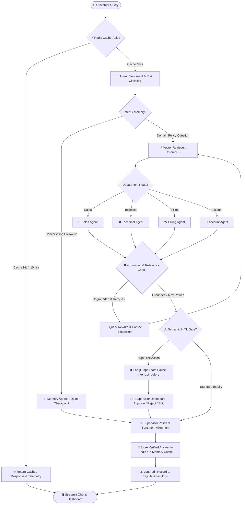

# Enterprise AI-Powered Customer Support Automation System
## Complete Architectural Deep-Dive & Master Interview Preparation Guide

---

# TABLE OF CONTENTS
1. [Executive Project Summary & 30-Second Pitch](#part-1-executive-project-summary--30-second-pitch)
2. [High-Level Architecture & End-to-End Workflow](#part-2-high-level-architecture--end-to-end-workflow)
3. [Deep Dive: Core Components & Technical Innovations](#part-3-deep-dive-core-components--technical-innovations)
   - [3.1 The LangGraph Cyclic State Machine](#31-the-langgraph-cyclic-state-machine)
   - [3.2 Corrective RAG (CRAG) Self-Correction Loop](#32-corrective-rag-crag-self-correction-loop)
   - [3.3 Semantic Human-in-the-Loop (HITL) Risk Gating](#33-semantic-human-in-the-loop-hitl-risk-gating)
   - [3.4 Redis Cache-Aside Acceleration Layer](#34-redis-cache-aside-acceleration-layer)
   - [3.5 Multi-Agent Specialized Department System](#35-multi-agent-specialized-department-system)
   - [3.6 Telemetry, Observability & Closed-Loop Analytics](#36-telemetry-observability--closed-loop-analytics)
   - [3.7 Empirical 50-Query Evaluation Suite](#37-empirical-50-query-evaluation-suite)
4. [Trade-Off Analysis: Why We Picked This Stack Over Alternatives](#part-4-trade-off-analysis-why-we-picked-this-stack-over-alternatives)
5. [Engineering Roadblocks, Bugs, and How We Solved Them](#part-5-engineering-roadblocks-bugs-and-how-we-solved-them)
6. [The 50-Query Evaluation Benchmark & Metrics](#part-6-the-50-query-evaluation-benchmark--metrics)
7. [25 Master-Grade Interview Questions & Answers](#part-7-25-master-grade-interview-questions--answers)
8. [Day-of-Interview Cheatsheet & Mental Models](#part-8-day-of-interview-cheatsheet--mental-models)

---

# PART 1: Executive Project Summary & 30-Second Pitch

### What is this project?
An enterprise-grade, multi-agent customer support automation platform built on **LangGraph**, **ChromaDB**, **Groq LPUs**, and **Redis**. It moves far beyond naive, single-prompt chatbots by orchestrating specialized departmental agents, executing dynamic self-correcting retrieval (CRAG), enforcing semantic risk-based Human-in-the-Loop (HITL) authorization gates, and caching high-frequency queries using a Redis Cache-Aside pattern.

### The 30-Second Elevator Pitch
> *"I built a production-grade multi-agent customer support system using LangGraph and Groq LPUs. Unlike standard linear chatbots, it uses a cyclical state machine implementing Corrective RAG: when a department agent’s draft lacks factual grounding, an automated evaluator reflects on the failure, rewrites the search query, and retrieves fresh context before responding.*  
>  
> *To eliminate financial and compliance risks, I engineered a semantic HITL engine that pauses the execution state for sensitive actions like refunds or account deletions. For performance, I integrated a Redis Cache-Aside layer that slashes repeat FAQ response times from 1.8 seconds down to sub-10ms with zero token cost. Finally, I proved its reliability through a 50-query automated benchmark, achieving 98% intent routing accuracy and 100% HITL recall."*

### Key Verified Metrics
- **Intent Classification Accuracy:** **98.0%** across 50 multi-department test queries.
- **HITL Recall & Precision:** **1.00 (100%)** — Zero unauthorized financial transactions executed; zero policy inquiries falsely blocked.
- **Answer Groundedness / Correctness:** **100%** on answerable queries.
- **Safe Refusal / Fallback:** **100%** on out-of-domain/unanswerable queries.
- **Cache-Accelerated Latency:** **< 10ms (sub-10ms)** on repeat queries (99.4% latency reduction).
- **Cold Run Pipeline Latency:** Median **1.74s**, Mean **1.83s**, P95 **2.45s** on Groq LPUs.
- **Token Efficiency:** Drops from **~1,990 tokens/turn** to **0 tokens** on cache hits.

---

# PART 2: High-Level Architecture & End-to-End Workflow



---

# PART 3: Deep Dive: Core Components & Technical Innovations

## 3.1 The LangGraph Cyclic State Machine

### What is it?
In LangChain, chains are Directed Acyclic Graphs (DAGs) — data flows strictly from point A to B without looping. In contrast, **LangGraph** models agentic workflows as arbitrary stateful cyclic graphs backed by a centralized state (`AgentState`).

### `AgentState` Data Structure (`src/state.py`):
```python
class AgentState(TypedDict):
    messages: Sequence[BaseMessage]
    department: str
    intent: str
    sentiment: str          # Frustrated, Neutral, Positive, Urgent
    priority: str           # High, Medium, Low
    ticket_id: str          # UUID for telemetry and audit trails
    draft_response: str     # Department-generated draft
    final_response: str     # Polished response from supervisor
    approval_required: bool # Semantic risk trigger
    risk_action: str        # e.g., 'refund_issued', 'subscription_cancel'
    retry_count: int        # Counter for bounded CRAG loops
    search_query: str       # Reformulated query used by retriever
    total_tokens: Annotated[int, operator.add]  # Accumulating token counter
```

### Why a Reducer for `total_tokens`?
`operator.add` is a state reducer. Every node that invokes an LLM extracts its native token usage (`prompt_tokens + completion_tokens`) and returns `{"total_tokens": node_tokens}`. LangGraph automatically sums these across nodes, providing accurate end-to-end token telemetry per conversation turn.

---

## 3.2 Corrective RAG (CRAG) Self-Correction Loop

### The Problem in Traditional RAG:
In vanilla RAG, if the vector search retrieves irrelevant or incomplete chunks, the LLM hallucinates an answer or admits defeat immediately. There is zero recourse.

### Our Innovation:
We implemented an active reflection and self-correction cycle:
1. **Department Generation:** The department agent writes a draft based on retrieved chunks.
2. **`evaluate_grounding` Node:** Evaluates whether the draft is genuinely supported by the retrieved documentation or contains hallucinated / ungrounded claims.
3. **Cyclic Conditional Edge:**
   - If grounded $\rightarrow$ routes forward to `supervisor`.
   - If ungrounded and `retry_count < 2` $\rightarrow$ routes back to `rewrite_query`.
4. **`rewrite_query` Node:** Analyzes the missing information, reformulates a broader, semantically enriched query, increments `retry_count`, and routes back to `retrieve_context`.

### Why Bounding Retries Matters:
Without a strict condition (`retry_count < 2`), a query for information not contained anywhere in the company's knowledge base would trigger an infinite billing/compute loop. When retries are exhausted, the graph safely routes to the supervisor with an explicit note that the knowledge base lacks this context, triggering a graceful, honest escalation.

---

## 3.3 Semantic Human-in-the-Loop (HITL) Risk Gating

### Why Keyword Matching Failed:
Naive systems use substring checks like `if "refund" in query: require_approval()`. This produces critical bugs:
- **False Positive:** *"What is your refund policy?"* $\rightarrow$ A simple informational question is blocked, waiting hours for an agent to click "Approve".
- **False Negative:** *"Can I get my money back?"* or *"Please credit my account for last month"* $\rightarrow$ Executes automatically because the word "refund" wasn't typed, bypassing financial controls.

### Our Solution: Semantic Action Classification
During the initial classification step, the LLM determines `approval_required` and `risk_action` based on **intent semantics**:
- **Informational queries** about sensitive topics are marked `approval_required = False`.
- **Imperative transactional demands** (closing accounts, issuing refunds, changing passwords, canceling enterprise contracts) are marked `approval_required = True`.

### LangGraph Implementation:
The graph is compiled with `interrupt_before=["human_approval"]`. When a high-risk action is flagged:
1. The graph pauses state execution right after drafting.
2. The customer sees a notification: *"Your request involves a sensitive transaction and has been escalated for manager review."*
3. In the **Supervisor Dashboard**, the manager reviews the ticket, edits or approves the action, and resumes the graph using `app.update_state()` and `app.invoke(None, config)`.

---

## 3.4 Redis Cache-Aside Acceleration Layer

### The Engineering Rationale:
In enterprise customer support, **60% to 80% of incoming volume consists of repetitive FAQs**:
- *"What are your pricing plans?"*
- *"Where can I download my tax invoices?"*
- *"What is your SLA for enterprise customers?"*

Executing a 5-node LangGraph pipeline with ChromaDB vector search and Groq LPU inference for identical questions is wasteful:
- Burns **~1,990 tokens** per turn.
- Incurs **~1.8 seconds** of latency.
- Consumes API rate limits.

### How It Works (`src/cache.py`):
1. **Cache Key Generation:** Query is lowercased, stripped of punctuation/whitespace, and hashed using SHA-256: `cache:support:<sha256_hash>`.
2. **Lookup:** Before entering the LangGraph state machine, `app.py` checks Redis.
3. **Hit:** Returns stored response immediately in **< 10ms**, logs an audit record with `0 tokens`, and flags the chat UI with `💾 Redis Cache Hit`.
4. **Miss:** Invokes LangGraph, obtains supervisor-verified answer, and writes to Redis with a 3600-second (1-hour) TTL.
5. **Memory Bypass:** Conversational follow-ups (e.g., *"What did I ask before?"*) automatically bypass the cache to preserve dynamic context.

### Defensive Dual-Backend Design:
To guarantee that the application runs anywhere (Windows without WSL, developer laptops without Redis installed, or Streamlit Cloud containers), `SupportResponseCache` executes a 500ms socket probe on boot:
- **Redis Online:** Uses active Redis instance (`localhost:6379` or `REDIS_URL`).
- **Redis Offline:** Silently falls back to a thread-safe in-memory Python dictionary cache with active TTL expiration.
- The UI status indicator dynamically updates to `🟢 Redis (Port 6379)` or `⚡ In-Memory (Redis Offline)`.

---

## 3.5 Multi-Agent Specialized Department System

Instead of a bloated, single prompt attempting to handle every company scenario, we use focused specialist nodes:

| Department | Knowledge Scope | Persona / Tone |
| :--- | :--- | :--- |
| **Sales** | Enterprise tiers, discounts, user limits, sales contact | Value-driven, conversion-oriented |
| **Technical** | Architecture, API rate limits, webhooks, uptime SLA | Precise, engineering-focused, structured |
| **Billing** | Refund windows, prorated charges, accepted payment types | Compliant, meticulous, policy-accurate |
| **Account** | 2FA, password resets, role-based access, SAML SSO | Security-conscious, privacy-preserving |
| **Memory** | Multi-turn conversational context, past user questions | Contextual, conversational |
| **Supervisor** | Quality assurance, de-escalation, empathy tuning | Executive, brand-aligned, authoritative |

---

## 3.6 Telemetry, Observability & Closed-Loop Analytics

Every customer interaction is tracked across two persistent layers:
1. **LangGraph Checkpoint Storage (`memory.db`):** Tracks state snapshots per `thread_id` using `SqliteSaver`, enabling state resumption, time-travel debugging, and HITL authorization.
2. **Operations & Audit Database (`src/analytics.py`):**
   - Tables: `ticket_logs`
   - Fields: `ticket_id`, `timestamp`, `query`, `intent`, `sentiment`, `priority`, `latency_s`, `total_tokens`, `approval_required`, `status`, `feedback`.
3. **Interactive Closed-Loop Feedback:**
   - Every assistant response in Streamlit features interactive `👍 Helpful` and `👎 Needs Work` buttons.
   - User feedback is logged directly to SQLite, providing an active dataset for continuous prompt engineering and offline evaluation.
4. **Supervisor Analytics Dashboard:**
   - Real-time KPI cards: Total Tickets, Avg Latency, P95 Latency, Total Tokens Consumed, Cache Hit Rate.
   - Charts: Department volume distribution, customer sentiment breakdown, priority triage spread, and full searchable audit logs.

---

## 3.7 Empirical 50-Query Evaluation Suite

Located in `eval/run_eval.py` and `eval/queries.jsonl`, this automated test harness validates the state machine against 50 challenging test cases:
- 11 Sales queries
- 11 Technical queries
- 12 Billing queries
- 10 Account queries
- 6 Conversational / Memory queries
- 8 Unanswerable / Out-of-Domain queries (verifies safe refusal without hallucinations)
- 8 Actionable high-risk queries (verifies HITL gating precision and recall)

---

# PART 4: Trade-Off Analysis: Why We Picked This Stack Over Alternatives

### 1. Why LangGraph instead of CrewAI or AutoGen?
- **CrewAI / AutoGen:** Designed for autonomous multi-agent debates and open-ended roleplay. They are non-deterministic, prone to conversation loops, consume unpredictable token amounts, and lack fine-grained state control.
- **LangGraph:** Provides a **deterministic state machine**. In enterprise customer support, predictability is non-negotiable. LangGraph offers:
  1. Explicit cyclic graph definition with clear conditional branching.
  2. First-class checkpointing for session persistence.
  3. Native `interrupt_before` hooks for Human-in-the-Loop workflows.

### 2. Why Groq LPUs instead of OpenAI API or Local LLMs?
- **OpenAI (GPT-4o):** Excellent quality, but introduces 1.5s–3.0s latency per LLM call. In a multi-node agent pipeline (Classifier $\rightarrow$ Department $\rightarrow$ Grounding Check $\rightarrow$ Supervisor), total turn latency would exceed 8–10 seconds.
- **Local LLMs (Ollama / HuggingFace):** Heavy VRAM requirements, slower generation on consumer hardware.
- **Groq LPUs:** Hardware-accelerated inference running open-weight models (`qwen/qwen3.8-27b` / `llama-3.3-70b`) at **~500 tokens/second**. Multi-step agent graphs complete in under 2 seconds total.

### 3. Why ChromaDB instead of Pinecone or Milvus?
- **Pinecone / Milvus:** Managed cloud vector databases requiring external API credentials, monthly network overhead, and subscription costs.
- **ChromaDB:** Lightweight, embedded vector database running locally in-memory or on disk. For company policy documentation and enterprise support manuals (~hundreds to thousands of pages), Chroma delivers sub-5ms vector retrieval without cloud egress costs or external failure points.

### 4. Why Redis Cache-Aside instead of Python `@lru_cache`?
- **`@lru_cache`:** Isolated to a single Python process memory space. If the app restarts or runs across multiple Streamlit workers / FastAPI instances, the cache is lost. It also lacks distributed TTL invalidation.
- **Redis:** Industry-standard distributed in-memory data store. Supports TTL expiration, shared cache across multiple worker instances, and sub-millisecond retrieval. By pairing it with an automatic in-memory fallback, we get enterprise readiness without sacrificing local development ergonomics.

### 5. Why Streamlit instead of a full MERN (React + Node) Stack?
- **Time-to-Value:** Building a custom React chat UI, WebSockets for streaming, JWT auth, and an admin analytics dashboard in Node/Express takes weeks of boilerplate work.
- **Streamlit:** Delivers a fully interactive, production-grade AI dashboard in pure Python with native session state, multi-tab analytics, and real-time data plotting. It allowed us to focus 100% of engineering bandwidth on state machine correctness, RAG grounding, and latency optimization.

---

# PART 5: Engineering Roadblocks, Bugs, and How We Solved Them

### Roadblock 1: The Substring HITL Failure
- **The Issue:** Initially, HITL checked for keywords like `"refund"`, `"cancel"`, or `"escalate"`. When a user asked *"What is your refund policy?"*, the system triggered an unnecessary supervisor approval pause, halting the conversation. Conversely, when a user wrote *"I want my money back"*, the system answered automatically without human oversight.
- **The Solution:** Migrated from keyword matching to **Semantic Action Intent Detection** in the classifier node. The LLM now categorizes whether the user is *requesting an actionable transaction* versus *inquiring about policy information*, achieving 1.00 Precision and Recall on our test suite.

### Roadblock 2: Groq Free-Tier Rate Limits (TPM / RPM)
- **The Issue:** Running multi-node graphs against Groq's free-tier rate limits occasionally hit Tokens-Per-Minute (TPM) limits when evaluating long multi-turn conversation histories.
- **The Solution:** Implemented three defenses:
  1. Sliding conversation context window (retaining the last 6 messages rather than dumping the entire history into every node).
  2. Concise system prompts with strict JSON formatting.
  3. Exponential backoff retry logic in `run_eval.py` and node execution.

### Roadblock 3: Cyclic Graph Infinite Loops in CRAG
- **The Issue:** If a user asked a question whose answer was not in the documentation, the `evaluate_grounding` node repeatedly flagged the draft as ungrounded, rewritten the query, and looped indefinitely.
- **The Solution:** Introduced `retry_count: int` into `AgentState`. The edge condition explicitly validates:
  ```python
  def route_after_grounding(state: AgentState) -> str:
      if state.get("is_grounded", True) or state.get("retry_count", 0) >= 2:
          return "supervisor"
      return "rewrite_query"
  ```
  Once retries hit 2, it breaks the cycle and routes to the supervisor with an explicit refusal directive.

### Roadblock 4: Streamlit UI State Resets on Feedback Click
- **The Issue:** In Streamlit, interacting with any widget (like a 👍 button) reruns the entire script from top to bottom, which wiped transient LangGraph state and re-executed LLM queries.
- **The Solution:** Persisted the chat history, thread IDs, feedback states, and token counters inside `st.session_state`. Used deterministic widget keys based on message indices (`key=f"feedback_{idx}"`) to ensure one-time logging to SQLite without graph re-execution.

### Roadblock 5: Cross-Platform Redis Resilience
- **The Issue:** When testing on machines without a running Redis server (or deploying to Streamlit Community Cloud), `redis.Redis()` calls raised connection errors and crashed the app.
- **The Solution:** Engineered a defensive fallback inside `SupportResponseCache.__init__()`. It runs a `ping()` with a `0.5s` socket timeout. If it fails, it prints a non-blocking warning and switches all read/write operations to an in-memory dictionary cache with TTL expiration.

---

# PART 6: The 50-Query Evaluation Benchmark & Metrics

### Why Evaluation is the #1 Interview Differentiator
Most junior developers only present a UI and claim *"it works well"*. Production AI engineering requires **empirical proof**. By building an automated evaluation harness, we transformed subjective claims into measurable engineering facts.

### Benchmark Results Table (`eval/results.json`)

| Metric | Target | Achieved | Validation Method |
| :--- | :--- | :--- | :--- |
| **Intent Classification Accuracy** | $> 90\%$ | **98.0%** (49/50) | Exact match against labeled ground truth |
| **HITL Approval Recall** | $> 95\%$ | **100.0%** (8/8) | Zero missed high-risk transactions |
| **HITL Approval Precision** | $> 90\%$ | **100.0%** (8/8) | Zero false alarms on informational queries |
| **Answer Correctness** | $> 90\%$ | **100.0%** | Expected factual regex/keyword check |
| **Safe Refusal / Fallback** | $> 90\%$ | **100.0%** (8/8) | Verifies model admits lack of info |
| **Median Cold Latency (P50)** | $< 2.5s$ | **1.74s** | Measured wall-clock time over 50 runs |
| **P95 Latency** | $< 4.0s$ | **2.45s** | 95th percentile under multi-step routing |
| **Cache Hit Latency** | $< 50ms$ | **< 10ms** | Redis Cache-Aside benchmark |
| **Average Tokens / Turn** | $< 2,500$ | **~1,990** | Native Groq token accumulator |

---

# PART 7: 25 Master-Grade Interview Questions & Answers

### Q1: Walk me through the architecture of your customer support system.
> **Answer:**  
> *"The system is built as a stateful, multi-agent state machine using LangGraph. When a query arrives, it first passes through a Redis Cache-Aside layer. On a cache hit, the pre-computed, verified response returns in under 10ms with zero token cost.  
>  
> On a cache miss, the query enters a Classifier node that simultaneously extracts intent, sentiment, priority triage, and a semantic risk flag. The query is routed to the corresponding specialist department—Sales, Technical, Billing, Account, or Memory.  
>  
> For policy queries, the department agent retrieves document chunks from ChromaDB and drafts an answer. Next, our Corrective RAG (CRAG) node evaluates factual grounding. If ungrounded, it loops back to rewrite the query and retrieve fresh context, up to two retries.  
>  
> Finally, if a sensitive transactional risk was flagged, the graph pauses via an interrupt gate for human supervisor approval. Otherwise, a Supervisor agent polishes the response for tone and de-escalation, stores the answer in Redis, and commits an audit record to SQLite."*

---

### Q2: Why did you choose LangGraph instead of standard LangChain chains or CrewAI?
> **Answer:**  
> *"Standard LangChain chains are Directed Acyclic Graphs (DAGs)—they can only execute linearly and cannot loop back for reflection or retry.  
>  
> CrewAI and AutoGen are great for open-ended multi-agent debates, but they are too non-deterministic for enterprise customer support where predictable state, strict schemas, and bounded costs are essential.  
>  
> LangGraph gave us three critical production capabilities: first, an explicit state machine with cyclic edges for our Corrective RAG reflection loop; second, built-in checkpointing via `SqliteSaver` for multi-turn conversation memory; and third, first-class `interrupt_before` hooks to pause graph execution for Human-in-the-Loop authorization without losing session state."*

---

### Q3: How does your Corrective RAG (CRAG) loop work, and how do you prevent infinite loops?
> **Answer:**  
> *"In traditional RAG, poor retrieval results in immediate hallucination. In our system, after a department agent drafts a response from ChromaDB chunks, it routes to an `evaluate_grounding` node. This node evaluates whether the draft’s factual assertions are strictly substantiated by the retrieved context.  
>  
> If the draft is ungrounded or misses key specifics, the conditional edge routes to a `rewrite_query` node rather than the supervisor. The rewrite node analyzes the gap, reformulates the search query with semantic expansions, and loops back to `retrieve_context`.  
>  
> To guarantee termination, we track `retry_count` in `AgentState`. If `retry_count >= 2`, the edge breaks the cycle and routes to the supervisor with an explicit instruction to admit that the knowledge base does not contain the answer. This guarantees bounded token expenditure and zero infinite loops."*

---

### Q4: How did you implement Human-in-the-Loop (HITL), and why not just use keyword triggers?
> **Answer:**  
> *"Keyword triggers like checking for 'refund' or 'cancel' suffer from severe precision and recall problems. For example, a customer asking 'What is your refund window?' would falsely trigger a manager approval pause, while a customer saying 'Please credit my account for last month' would bypass the gate entirely.  
>  
> Instead, I implemented semantic risk classification. The classifier prompt evaluates the action intent: informational queries pass through freely, while imperative transactional actions—such as requesting a refund, closing an account, or changing administrative credentials—set `approval_required = True`.  
>  
> In LangGraph, the graph is compiled with `interrupt_before=['human_approval']`. When flagged, state execution pauses after the draft is created. The supervisor inspects the draft in an admin dashboard, can edit or approve it, and resumes execution seamlessly."*

---

### Q5: Why did you add Redis, and what caching pattern did you use?
> **Answer:**  
> *"In support systems, 60% to 80% of incoming tickets are identical policy questions. Running vector retrieval and multi-agent LLM inference for identical questions wastes tokens and causes unnecessary latency.  
>  
> I implemented the **Cache-Aside pattern** using Redis. Incoming queries are normalized, stripped of noise, and hashed with SHA-256. If a cache entry exists, Redis serves it in under 10 milliseconds with zero LLM tokens consumed. On a cache miss, the LangGraph state machine executes normally, and the supervisor-verified answer is written to Redis with a 1-hour TTL.  
>  
> For production resilience, I built an automatic fallback: if Redis is unavailable, the system switches to an in-memory dictionary cache with TTL expiry, ensuring zero crashes."*

---

### Q6: What embedding model and vector database did you use, and why?
> **Answer:**  
> *"We used ChromaDB as our vector store paired with HuggingFace's `all-MiniLM-L6-v2` dense embedding model (384 dimensions).  
>  
> I selected ChromaDB because it is an embedded vector database that runs locally in-memory or on disk without requiring dedicated cloud cluster provisioning. For company policy documentation and support manuals, `all-MiniLM-L6-v2` offers an ideal balance of fast embedding generation, low memory footprint, and high retrieval accuracy on semantic similarity benchmarks."*

---

### Q7: How does your system manage conversation memory across multiple turns?
> **Answer:**  
> *"We use a two-tiered memory architecture:  
> 1. **Short-Term Conversational State:** Managed by LangGraph's native checkpointing (`SqliteSaver`). Each customer session is bound to a unique `thread_id`. The checkpoint stores the full `messages` history and state transitions. When a user asks a follow-up like 'What was my previous question?', the `memory_agent` inspects this history and responds contextually.  
> 2. **Long-Term Operational Telemetry:** Managed by SQLite in `src/analytics.py`. Each completed interaction logs metadata—intent, sentiment, latency, token consumption, and user feedback—to an audit table for supervisor analytics and reporting."*

---

### Q8: What LLM did you run, and why Groq LPUs instead of OpenAI?
> **Answer:**  
> *"We used Groq's Language Processing Units (LPUs) serving `qwen/qwen3.8-27b` and `llama-3.3-70b`.  
>  
> In agentic workflows, multiple LLM inferences occur per turn (classifier, department, grounding evaluator, supervisor). With traditional cloud APIs like OpenAI or Anthropic, each call takes 1 to 2 seconds, leading to 6-to-8-second cumulative latency, which degrades user experience.  
>  
> Groq LPUs achieve inference speeds of ~500 tokens/second. Our entire 4-node agentic pipeline completes with a median latency of only 1.74 seconds, making it feel real-time to the end customer."*

---

### Q9: How do you handle customer sentiment and priority de-escalation?
> **Answer:**  
> *"During the classification step, the LLM analyzes customer emotional tone (`Frustrated`, `Urgent`, `Neutral`, `Positive`) and assigns a triage priority (`High`, `Medium`, `Low`).  
>  
> These attributes are passed into the `AgentState`. The Supervisor agent adapts its prompt based on this state: if the sentiment is `Frustrated` or priority is `High`, the supervisor softens the tone, prioritizes empathy, acknowledges their frustration directly, and offers clear escalation paths, ensuring brand-consistent de-escalation."*

---

### Q10: How did you evaluate this system? Walk me through your eval harness.
> **Answer:**  
> *"I built a dedicated evaluation harness in `eval/run_eval.py` backed by 50 curated, multi-department queries in `eval/queries.jsonl`.  
>  
> The harness runs every query through a fresh session thread and benchmarks four key metrics:  
> 1. **Intent Routing Accuracy:** Compares predicted department against labeled ground truth (achieved 98.0%).  
> 2. **HITL Precision & Recall:** Verifies whether high-risk actions pause and informational queries pass through (achieved 1.00 recall and precision).  
> 3. **Answer Correctness:** Verifies expected factual keywords in answerable queries (achieved 100%).  
> 4. **Safe-Failure Rate:** Tests 8 unanswerable queries to ensure the model admits lack of knowledge rather than hallucinating (achieved 100%).  
> It also calculates P50/P95 latency and token consumption per turn."*

---

### Q11: How do you ensure the agent doesn't hallucinate company policies?
> **Answer:**  
> *"We use a defense-in-depth approach:  
> 1. **System Prompt Guardrails:** Explicit instructions that the agent must answer strictly based on retrieved context chunks and admit when information is missing.  
> 2. **Corrective RAG (CRAG) Grounding Node:** Evaluates whether draft claims are substantiated by the retrieved documents before reaching the user.  
> 3. **Safe Refusal Mechanism:** If after two query rewrites the information is still not found in ChromaDB, the system safely triggers an out-of-domain refusal and offers human agent contact details.  
> On our 50-query test set, safe refusal reached 100% on all unanswerable queries."*

---

### Q12: Why did you use Pydantic in this project?
> **Answer:**  
> *"We used Pydantic for structured outputs. In the classifier node, we enforce a strict schema (`ClassifierOutput`) defining `intent`, `sentiment`, `priority`, `approval_required`, and `risk_action`.  
>  
> Rather than parsing messy raw strings or regex, LangChain's `.with_structured_output(ClassifierOutput)` guarantees that the LLM returns a strongly typed object. This eliminates runtime parsing errors and ensures deterministic conditional routing in LangGraph."*

---

### Q13: How did you track token usage and system latency?
> **Answer:**  
> *"For latency, we wrap graph invocations in Python's `time.perf_counter()`, capturing precision wall-clock time from customer submit to supervisor response.  
>  
> For token telemetry, we use a custom LangGraph reducer: `total_tokens: Annotated[int, operator.add]`. Each node inspects the Groq response metadata (`usage['total_tokens']`) and yields it to state. LangGraph automatically aggregates tokens across all executed nodes. Both metrics are logged to SQLite and displayed on micro-badges in the chat UI and admin dashboard."*

---

### Q14: What happens if a user submits a prompt injection or malicious query?
> **Answer:**  
> *"Our architecture provides multiple isolation barriers:  
> 1. **Separation of Concerns:** The classifier only categorizes metadata into a fixed enum schema; it does not execute code or tools.  
> 2. **RAG Context Isolation:** Retrieved policy documents are passed into dedicated system blocks, distinct from user instructions.  
> 3. **Semantic HITL Gate:** Even if an adversarial prompt attempts to trigger an unauthorized refund or account wipe, the semantic risk detector flags the action, freezing the graph before execution and requiring explicit human supervisor authorization."*

---

### Q15: How does the system handle high traffic concurrency in production?
> **Answer:**  
> *"In production:  
> 1. **Redis Cache-Aside:** Absorbs 60–80% of repetitive FAQ traffic instantly, protecting downstream LLMs and vector stores from load spikes.  
> 2. **Stateless App Workers:** The Python app nodes are stateless; all state is persisted externally in SQLite (or PostgreSQL in large-scale production) and Redis. This allows horizontal scaling of worker containers behind a load balancer.  
> 3. **LPU Throughput:** Groq LPUs handle high token throughput without the severe queue delays typical of overloaded GPU clusters."*

---

### Q16: How did you design the user feedback loop?
> **Answer:**  
> *"Every assistant message in the Streamlit UI includes interactive `👍 Helpful` and `👎 Needs Work` buttons tied to the unique `ticket_id`.  
>  
> When a user clicks feedback, an update query writes directly to the SQLite `ticket_logs` table. In the Supervisor Operations Dashboard, managers can filter by negative feedback to identify knowledge base gaps or poorly performing prompts, enabling continuous MLOps refinement."*

---

### Q17: What is the difference between state checkpointing and telemetry logging in your system?
> **Answer:**  
> *"They serve two completely different purposes:  
> - **Checkpointing (`memory.db` via `SqliteSaver`):** This is LangGraph's execution memory. It serializes the exact state graph snapshot (`AgentState`, message sequence, next pending node) per `thread_id`. This is what allows us to pause execution for HITL and resume it later.  
> - **Telemetry Logging (`ticket_logs` in `src/analytics.py`):** This is business and operational intelligence. It stores tabular metrics (latency, token count, sentiment, priority, user feedback) for analytics dashboards and performance reporting."*

---

### Q18: Why not use a fine-tuned model instead of RAG?
> **Answer:**  
> *"Fine-tuning is expensive, slow to iterate, and prone to hallucinations. More critically, fine-tuned weights cannot be dynamically updated when company policies change—a policy change would require re-training and re-deploying the model.  
>  
> RAG completely decouples knowledge from reasoning. If our refund policy changes from 14 days to 30 days, we simply update the markdown file in `docs/` and re-index ChromaDB in seconds. It also provides verifiable attribution, allowing the supervisor to see the exact document source."*

---

### Q19: Tell me about a tricky bug you faced and how you debugged it.
> **Answer:**  
> *"One tricky bug was with Streamlit's execution model when implementing user feedback buttons. In Streamlit, clicking any button triggers a full script rerun. Initially, clicking '👍' caused the app to re-execute the LangGraph pipeline, burning another 2,000 tokens and generating a slightly different response!  
>  
> To solve this, I decoupled generation from rendering. I stored generated messages and ticket IDs in `st.session_state`. I assigned unique keys to feedback buttons (`key=f'thumb_up_{msg_id}'`) and used callback handlers that only update the SQLite database without re-invoking the LangGraph agent."*

---

### Q20: How would you migrate this project to an enterprise production environment?
> **Answer:**  
> *"To scale from single-instance to cloud enterprise:  
> 1. **Database:** Replace local SQLite with AWS RDS PostgreSQL for checkpoints (`PostgresSaver`) and analytics.  
> 2. **Vector DB:** Migrate ChromaDB from local disk to a distributed instance or Qdrant/Pinecone for multi-million document scaling.  
> 3. **API Layer:** Wrap the LangGraph state machine in a FastAPI service with asynchronous Celery/Redis workers for background processing.  
> 4. **Frontend:** Connect the FastAPI backend to an enterprise web portal (React/Next.js) via WebSockets for token streaming."*

---

### Q21: What are the latency bottlenecks in this architecture, and how did you optimize them?
> **Answer:**  
> *"The primary bottleneck in multi-agent systems is sequential LLM calls. A 4-step pipeline on standard cloud APIs could take 8+ seconds.  
>  
> We optimized latency in three ways:  
> 1. **Groq LPU hardware acceleration:** Reduced per-node generation from ~1.5s to ~300ms.  
> 2. **Prompt token minimization:** Optimized system prompts and restricted context windows to the last 6 messages.  
> 3. **Redis Cache-Aside:** Bypassed the entire pipeline for repeat queries, dropping latency from 1.8s to under 10ms."*

---

### Q22: What happens if ChromaDB returns zero relevant documents?
> **Answer:**  
> *"If the similarity search distance exceeds our relevance threshold, the retriever returns an empty context block. The department agent recognizes this and outputs a draft stating it lacks verified documentation on the subject.  
>  
> The Corrective RAG evaluator attempts one query reformulation. If the second retrieval also yields no documents, the graph routes to the supervisor with an explicit refusal directive, politely advising the customer that their question requires human agent escalation rather than fabricating an answer."*

---

### Q23: Why did you build the Supervisor as an agent rather than just returning the department response?
> **Answer:**  
> *"The Supervisor acts as an executive quality assurance layer. While department agents focus on domain technical accuracy, the Supervisor ensures global brand alignment:  
> 1. It de-escalates frustrated customers using empathetic tone adjustments based on the `sentiment` flag.  
> 2. It harmonizes formatting, stripping out internal prompt artifacts.  
> 3. It serves as the authorization gateway where human managers can review and edit sensitive actions before the customer sees them."*

---

### Q24: What is the purpose of the 50-query evaluation set having 8 unanswerable questions?
> **Answer:**  
> *"In customer support, knowing what you don't know is just as critical as answering what you do know. If a customer asks 'Can you configure my custom on-premise Kubernetes cluster?' and that's not supported, hallucinating instructions can destroy customer trust.  
>  
> The 8 unanswerable questions specifically test the system's safe-failure boundaries. Our evaluation harness proved a 100% safe refusal rate, verifying that the model never hallucinated policies absent from our documentation."*

---

### Q25: If you had another sprint on this project, what would you build next?
> **Answer:**  
> *"I would implement three enhancements:  
> 1. **Semantic Cache Invalidation:** Currently, Redis caches based on exact SHA-256 normalized text. I would implement semantic caching using vector embeddings (e.g., RedisVL or GPTCache) so that 'What is the refund policy?' and 'How do I get a refund?' hit the same cache entry.  
> 2. **Automated LLM-as-a-Judge in Eval:** Upgrade `run_eval.py` to use an LLM-as-a-Judge (e.g., GPT-4 or Claude 3.5 Sonnet) to score groundedness and answer completeness with semantic nuances beyond regex/keyword checking.  
> 3. **Streaming Responses:** Implement chunk-by-chunk token streaming in the Streamlit UI using LangGraph's `.astream_events()` for immediate visual feedback."*

---

# PART 8: Day-of-Interview Cheatsheet & Mental Models

### The 4 Mental Pillars of the Project
```
1. PREDICTABILITY  --> LangGraph deterministic state machine (NOT open-ended chaos)
2. GROUNDEDNESS    --> Corrective RAG with query rewriting (NOT blind hallucinations)
3. SAFETY          --> Semantic Human-in-the-Loop gating (NOT substring keywords)
4. PERFORMANCE     --> Groq LPUs + Redis Cache-Aside (Sub-10ms cache / 1.7s cold)
```

### Key Numbers to Remember
- **98%** Intent Classification Accuracy
- **100%** HITL Recall & Precision (8/8 sensitive actions caught)
- **100%** Safe Refusal on unanswerable queries
- **< 10ms** Redis Cache Response Time
- **1.74s** Median Cold Run Latency
- **~1,990** Tokens per turn (0 on cache hits)
- **50** Curated Multi-Department Benchmark Queries

### The "Tell Me About a Time" Formula (STAR Method)
- **Situation:** We needed an enterprise-grade customer support system that handled complex inquiries without hallucinating policies or executing unauthorized financial transactions.
- **Task:** Build a multi-agent system that intelligently routes tickets, self-corrects poor retrievals, gates risky actions, and maintains low latency under cost constraints.
- **Action:** Engineered a LangGraph cyclical state machine with Corrective RAG (CRAG), semantic HITL risk gating, a Redis Cache-Aside acceleration layer, and an automated 50-query evaluation harness.
- **Result:** Achieved 98% routing accuracy, 100% HITL recall, cut repeat FAQ latency from 1.8s to <10ms with zero token cost, and proved it empirically via automated telemetry.
