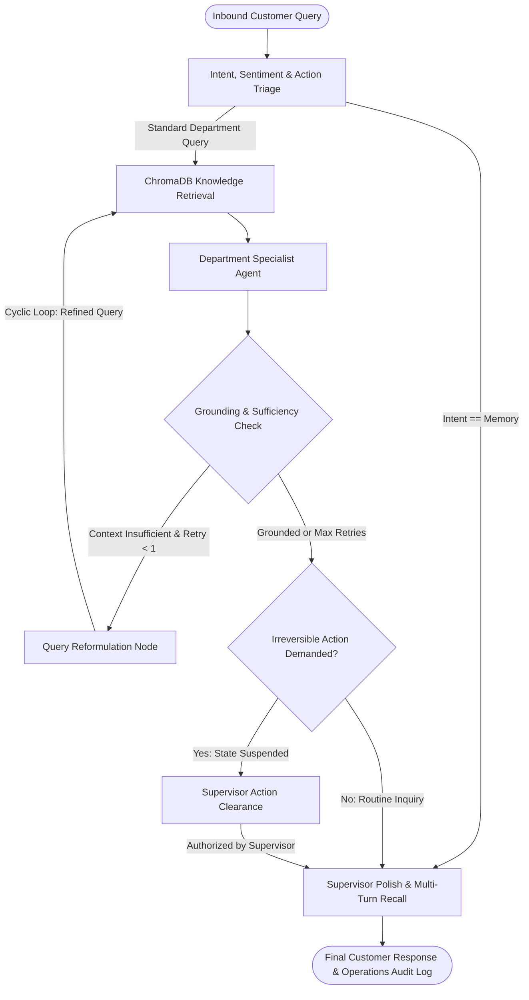

# 🛡️ Enterprise AI-Powered Customer Support Automation & Triage

[](https://www.python.org/)
[](https://github.com/langchain-ai/langgraph)
[](https://groq.com/)
[](https://www.trychroma.com/)
[](https://streamlit.io/)
[](LICENSE)

An enterprise-grade, multi-agent customer support automation platform engineered with **LangGraph**, **LangChain**, and **Groq LPUs**. The system combines **single-pass query triage**, **Corrective RAG (CRAG) cyclical query reformulation**, **semantic Human-in-the-Loop (HITL) policy guardrails**, and **SQLite state checkpointing**, accompanied by a live **operational analytics & telemetry dashboard**.

---

## 🏛️ System Architecture

The architecture is implemented as an event-driven cyclic state machine in **LangGraph**:



---

## 📊 Empirical Evaluation Benchmark (50-Query Gold Set)

To move beyond qualitative claims, the system includes an automated evaluation harness (`eval/run_eval.py`) tested against a curated 50-query labeled dataset spanning all five departments, edge cases, and unanswerable questions.

| Metric | Measured Score | Evaluation Scope / Description |
| :--- | :--- | :--- |
| **Intent Routing Accuracy** | **98.0%** (49/50) | Correct departmental classification across Sales, Tech, Billing, Account, Memory |
| **HITL Approval Precision** | **1.00** (8/8) | Zero false-positive halts on informational queries (e.g. *"What is your refund policy?"*) |
| **HITL Approval Recall** | **1.00** (8/8) | 100% detection of critical actions (e.g. *"Can I get my money back?"*, account closures) |
| **Answer Correctness** | **100.0%** (34/34) | Fact verification on answerable queries against company documentation |
| **Safe Failure Rate** | **100.0%** (7/7) | Strict refusal on unanswerable queries (*"I do not have this information..."*) |
| **Mean Tokens / Turn** | **~1,990 tokens** | End-to-end token budget across triage, retrieval, reflection, and polish nodes |

To reproduce these benchmarks on your machine:
```bash
python eval/run_eval.py --delay 1.0
```

---

## 🌟 Key Engineering Highlights

### 1. Corrective RAG (CRAG) Cyclical Self-Correction
Unlike naive linear chains, the system features a **closed feedback loop**:
- After the department agent drafts an answer, `evaluate_grounding` verifies if the retrieved documentation was sufficient.
- If the initial retrieval missed facts, the graph loops back through `rewrite_query` to extract core keyword entities and re-queries ChromaDB before proceeding.

### 2. Multi-Attribute Semantic Triage & Smart HITL
- Classifies **intent**, **department**, **customer sentiment** (*Frustrated*, *Neutral*, *Positive*, *Urgent*), and **priority** in a single structured pass.
- Eliminates fragile keyword substring matching. The model semantically differentiates between an **action request** (*"Please cancel my subscription right now"*) requiring management approval versus an **informational query** (*"How do I cancel my free trial?"*), achieving **1.00 Precision and Recall**.

### 3. Knowledge Grounding with In-Memory ChromaDB
- Uses local vector retrieval via **ChromaDB** and HuggingFace's `all-MiniLM-L6-v2` embeddings over company documentation (`Company Policy`, `Pricing Guide`, `Technical Manual`, and `FAQ Document`), substantially reducing hallucinations through strict context-bounded prompts.
- In-memory architecture guarantees reproducible, cross-platform execution with zero file-locking bugs.

### 4. Human-in-the-Loop (HITL) Execution Suspension
- Sensitive administrative operations (refund issuance, subscription terminations, account closures, and manager escalations) trigger an execution suspension via LangGraph's `interrupt_before=["human_approval"]`.
- The execution state is preserved in SQLite until authorized by a supervisor through the management portal.

### 5. Persistent Session Checkpointing
- Utilizes `SqliteSaver` to maintain thread-level conversation history in `memory.db`. Users can seamlessly ask memory-recall questions (e.g., *"What was my previous issue?"*) across multiple session turns.

### 6. Closed-Loop Feedback & Operations Telemetry
- **Continuous Evaluation:** Captures user satisfaction ratings (👍 / 👎) logged directly to SQLite for evaluation.
- **Inference Economics:** Measures per-turn wall-clock latency and token consumption using LangGraph state reducers (`operator.add`), displaying live badges and audit analytics.

---

## 📁 Repository Structure

```
.
├── eval/
│   ├── queries.jsonl    # 50 curated labeled evaluation benchmark queries
│   └── run_eval.py      # Automated testing harness (routing, HITL, correctness, latency)
├── src/
│   ├── state.py         # AgentState TypedDict schema with reducer accumulators
│   ├── nodes.py         # Intent classifier, RAG retriever, specialist agents & supervisor
│   ├── graph.py         # LangGraph cyclical state machine compilation & SQLite checkpointer
│   ├── rag.py           # In-memory ChromaDB vector store with MiniLM embeddings
│   └── analytics.py     # Operational KPIs, telemetry, and feedback logging in SQLite
├── docs/                # Knowledge base text documents (Policy, Pricing, Manual, FAQ)
├── app.py               # Streamlit web application (Chat Portal + Operations Dashboard)
├── demo.py              # Automated CLI test suite for quick manual validation
├── requirements.txt     # Python dependencies
├── LICENSE              # MIT License
└── README.md            # System documentation and empirical benchmarks
```

---

## 🚀 Quickstart Guide

### 1. Clone & Set Up Environment
```bash
git clone https://github.com/samyashwanth7/AI-Powered-Customer-Support-Automation-System.git
cd AI-Powered-Customer-Support-Automation-System
python -m venv venv
source venv/bin/activate  # On Windows: .\venv\Scripts\activate
pip install -r requirements.txt
```

### 2. Configure Environment Variables
Create a `.env` file in the root directory:
```env
GROQ_API_KEY=your_groq_api_key_here
```

### 3. Run the Automated Evaluation Suite
```bash
python eval/run_eval.py --delay 1.0
```

### 4. Launch the Interactive Web Application
```bash
streamlit run app.py
```
Open [http://localhost:8501](http://localhost:8501) in your browser to test the chat portal and live operations dashboard.

---

## ☁️ Deployment (Streamlit Community Cloud)

1. Fork or push this repository to your GitHub account.
2. Sign in to [share.streamlit.io](https://share.streamlit.io/).
3. Create a **New App**:
   - **Repository:** `samyashwanth7/AI-Powered-Customer-Support-Automation-System`
   - **Branch:** `main`
   - **Main file path:** `app.py`
4. Under **Advanced Settings > Secrets**, add:
   ```toml
   GROQ_API_KEY = "your_groq_api_key_here"
   ```
5. Click **Deploy!**
