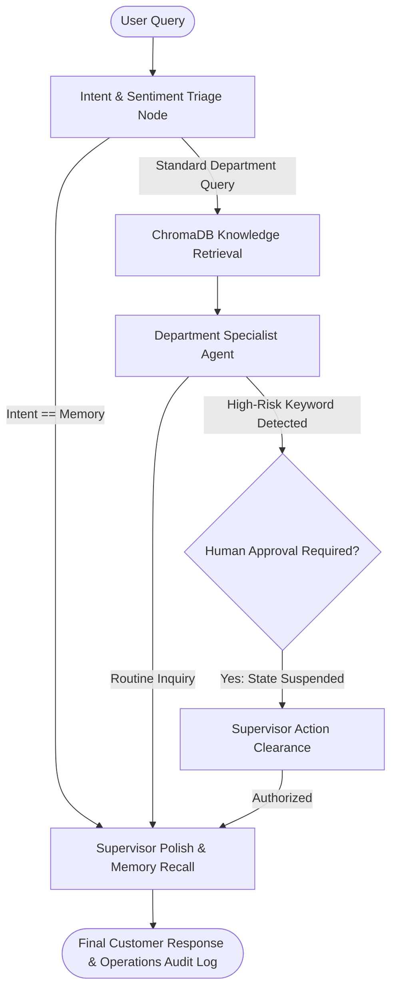

# 🛡️ Enterprise AI-Powered Customer Support Automation & Triage

[](https://www.python.org/)
[](https://github.com/langchain-ai/langgraph)
[](https://groq.com/)
[](https://www.trychroma.com/)
[](https://streamlit.io/)
[](LICENSE)

An enterprise-ready, multi-agent customer support automation platform engineered with **LangGraph**, **LangChain**, and **Groq LPUs**. The system combines **intent classification**, **real-time customer sentiment triage**, **Retrieval-Augmented Generation (RAG)**, **Human-in-the-Loop (HITL) policy guardrails**, and **SQLite state checkpointing**, accompanied by a live **operational analytics dashboard**.

---

## 🏛️ System Architecture



---

## 🌟 Key Engineering Highlights

### 1. Multi-Agent State Machine (LangGraph)
Unlike rigid, linear chains, the system is modeled as a cyclic state machine. The state maintains conversation messages, classified intent, departmental routing, retrieved context, triage metrics, and checkpointed approval states.

### 2. Real-Time Sentiment & Priority Triage
Every inbound query undergoes multi-attribute classification using structured Pydantic schema validation:
- **Department Routing:** Sales, Technical Support, Billing, Account Management.
- **Sentiment Triage:** Detects emotional state (*Frustrated*, *Neutral*, *Positive*, *Urgent*).
- **SLA Priority:** Automatically assigns ticket priority (*High*, *Medium*, *Low*).

### 3. Knowledge Grounding with RAG
Uses local vector retrieval via **ChromaDB** and HuggingFace's `all-MiniLM-L6-v2` embeddings over company documentation (`Company Policy`, `Pricing Guide`, `Technical Manual`, and `FAQ Document`), eliminating hallucinations.

### 4. Human-in-the-Loop (HITL) Guardrails
High-risk policy actions (refund requests, subscription terminations, account closures, and management escalations) trigger an execution suspension using LangGraph's `interrupt_before`. The workflow pauses until authorized by a supervisor through the management portal.

### 5. Persistent Session Checkpointing
Utilizes `SqliteSaver` to maintain thread-level conversation history in `memory.db`. Users can seamlessly ask memory-recall questions (e.g., *"What was my previous issue?"*) without losing session context.

### 6. Closed-Loop Feedback & Operations Dashboard
- **Continuous Evaluation:** Captures user satisfaction ratings (👍 / 👎) stored in SQLite for model fine-tuning and evaluation.
- **Real-Time Analytics:** Visual breakdown of ticket volume by department, customer sentiment distribution, priority breakdown, and an audit trail.

---

## 📁 Repository Structure

```
.
├── src/
│   ├── state.py         # AgentState TypedDict schema definition
│   ├── nodes.py         # Intent classifier, RAG retriever, specialist agents & supervisor
│   ├── graph.py         # LangGraph workflow compilation and SQLite checkpointer
│   ├── rag.py           # Document chunking and ChromaDB vector store
│   └── analytics.py     # Operational KPIs and feedback logging in SQLite
├── docs/                # Knowledge base text documents (Policy, Pricing, Manual, FAQ)
├── app.py               # Streamlit web application (Chat + Analytics Dashboard)
├── demo.py              # Automated CLI test suite for the 5 benchmark queries
├── requirements.txt     # Python dependencies
├── memory.db            # SQLite database storing checkpointer threads & analytics
└── workflow_diagram.png # Generated architecture state diagram
```

---

## 🚀 Quickstart Guide

### 1. Clone & Set Up Environment
```bash
git clone https://github.com/samyashwanth7/AI-Powered-Customer-Support-Automation-System.git
cd AI-Powered-Customer-Support-Automation-System
python -m venv venv
source venv/bin/activate  # On Windows: .\venv\Scripts\activate
pip install -r requirements.txt
```

### 2. Configure Environment Variables
Create a `.env` file in the root directory:
```env
GROQ_API_KEY=your_groq_api_key_here
```

### 3. Run the Demonstration CLI
Execute all 5 benchmark scenarios in one command:
```bash
python demo.py
```

### 4. Launch the Interactive Web Application
```bash
streamlit run app.py
```
Open [http://localhost:8501](http://localhost:8501) in your browser to experience the chat portal and live analytics dashboard.

---

## 🧪 Benchmark Queries & Validation Scenarios

| # | Query | Department | Triage | Expected Path |
|---|---|---|---|---|
| 1 | *What are the pricing plans available for your software?* | Sales | Low Priority | RAG retrieval from Pricing Guide -> Supervisor refinement |
| 2 | *I forgot my account password.* | Account | Medium Priority | RAG retrieval from Policy -> Step-by-step password recovery |
| 3 | *My application crashes whenever I upload a file.* | Technical | High Priority / Frustrated | Technical Manual troubleshooting -> Empathetic de-escalation |
| 4 | *I need a refund for my annual subscription.* | Billing | High Priority | **HITL Triggered:** Execution suspended -> Supervisor approval |
| 5 | *What was my previous support issue?* | Memory | Neutral | Direct SQLite memory recall across past session turns |

---

## ☁️ Deployment (Streamlit Community Cloud)

1. Fork or push this repository to GitHub.
2. Sign in to [share.streamlit.io](https://share.streamlit.io/).
3. Create a **New App**:
   - **Repository:** `samyashwanth7/AI-Powered-Customer-Support-Automation-System`
   - **Branch:** `main`
   - **Main file path:** `app.py`
4. Under **Advanced Settings > Secrets**, add:
   ```toml
   GROQ_API_KEY = "your_groq_api_key_here"
   ```
5. Click **Deploy!**

---

## 📄 License
This project is licensed under the MIT License.
